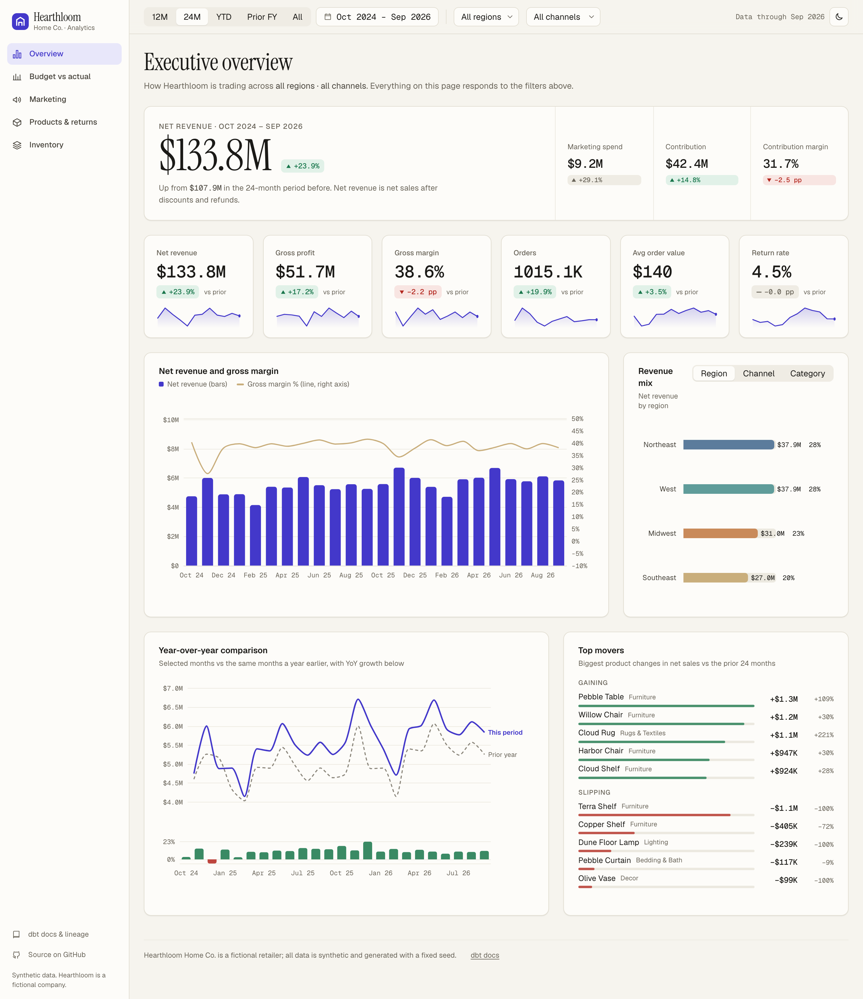
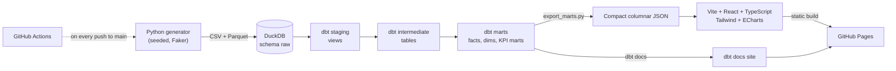
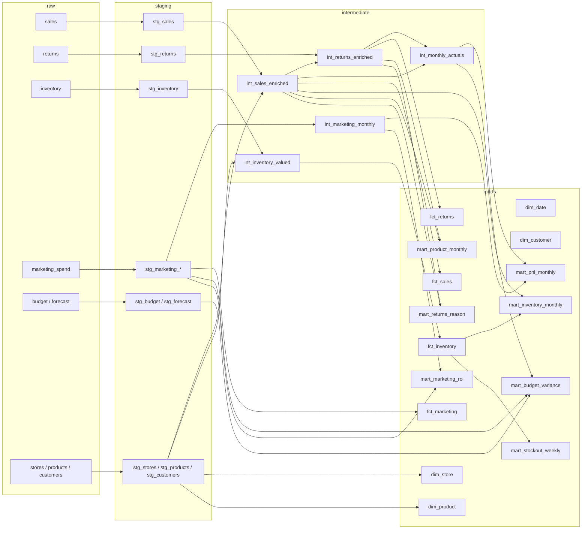
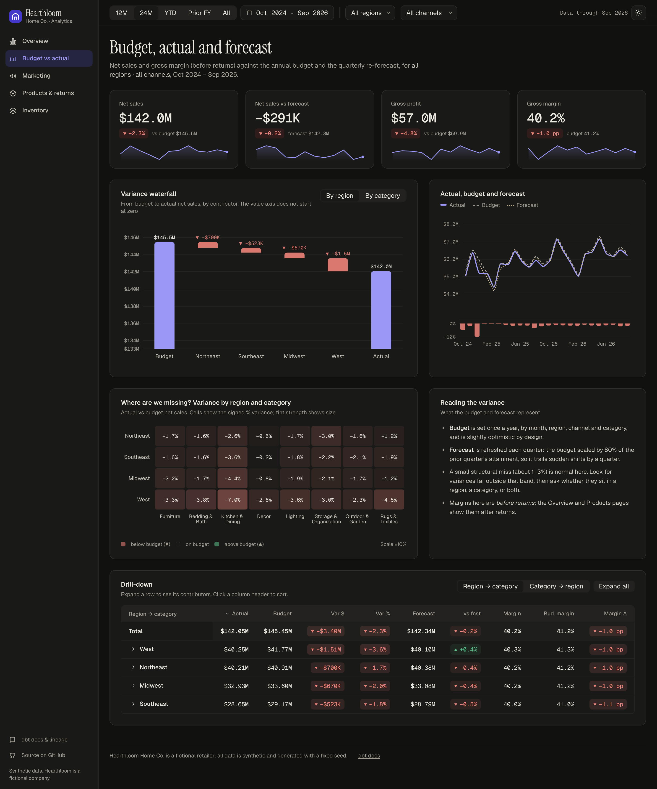
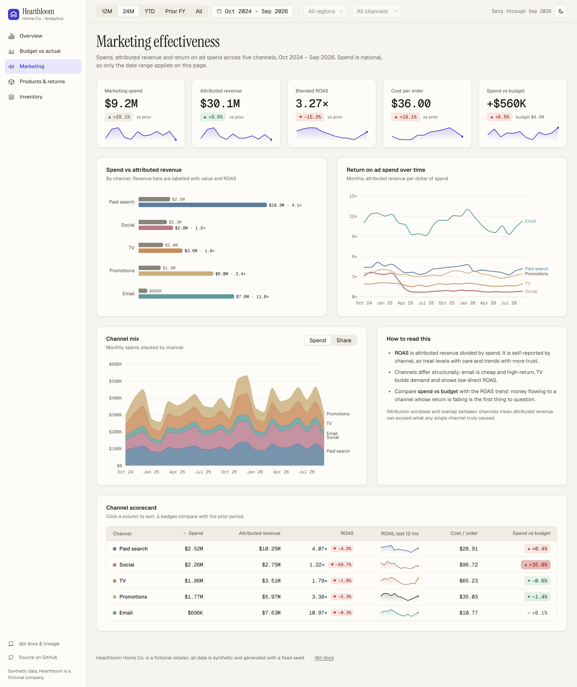
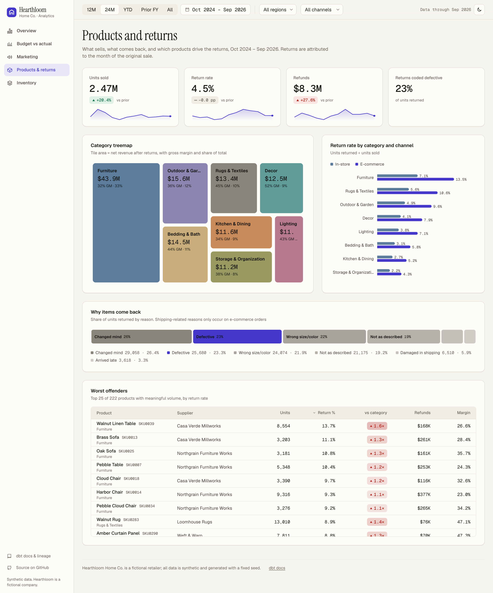
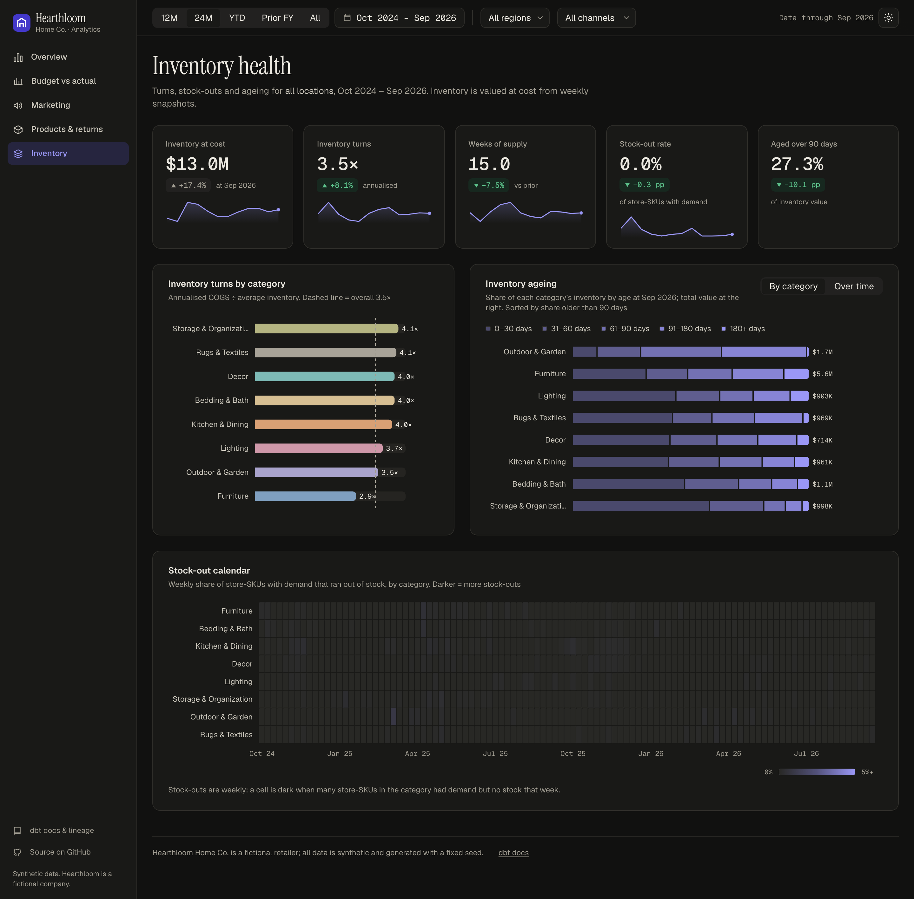

<div align="center">

# Hearthloom Analytics

### A fake company with real problems to find.
Five years of retail data, a dbt + DuckDB warehouse, and a hand-built dashboard. Fully reproducible, one command to run.

[](https://cher-ry2003.github.io/hearthloom-analytics/)
[](https://cher-ry2003.github.io/hearthloom-analytics/dbt-docs/index.html)
[](https://github.com/cher-ry2003/hearthloom-analytics/actions/workflows/deploy.yml)


**[Open the live dashboard](https://cher-ry2003.github.io/hearthloom-analytics/)**

<a href="https://cher-ry2003.github.io/hearthloom-analytics/"></a>

</div>

## Why this exists

Most public datasets are clean, tiny, and have nothing hidden in them. Real analysis work is the opposite: a region
quietly misses plan, a channel stops paying back, a supplier raises costs and a margin slips. This project gives you a
believable business where those things have **already happened**, so you can practise finding them, from raw tables
through dbt models to a dashboard.

- **Practise variance analysis** on a budget, a quarterly forecast and five years of actuals.
- **Learn analytics engineering** from a complete, tested dbt project (staging, intermediate, marts, 103 tests).
- **Study dashboard design** in a hand-built React site, not a BI tool: light and dark themes, keyboard focus, AA contrast.
- **Reuse it**: the generator is seeded, so everyone sees the same numbers, and CI rebuilds the whole thing on every push.

> There are **8 hidden problems** in the data. The dashboard never mentions them. When you want to check your work,
> [`ANSWER_KEY.md`](ANSWER_KEY.md) lists each one with how to find it (spoilers).

## Try it in 60 seconds

```bash
git clone https://github.com/cher-ry2003/hearthloom-analytics.git
cd hearthloom-analytics
make setup   # virtualenv + Python and Node dependencies (once)
make all     # generate data -> DuckDB -> dbt build + tests -> JSON -> static site in dashboard/dist
make dev     # open the dashboard locally with hot reload
```

Or skip setup entirely and just [use the live dashboard](https://cher-ry2003.github.io/hearthloom-analytics/).

**Contents:** [The company](#the-company) · [Architecture](#architecture) · [Run locally](#run-everything-locally) ·
[dbt lineage](#dbt-model-lineage) · [Dashboard](#the-dashboard) · [Practice questions](#practice-questions) · [Layout](#repository-layout)

## The company

**Hearthloom Home Co.** is an invented mid-size US home-goods retailer.

| | |
|---|---|
| Footprint | 40 physical stores in 4 regions (Northeast, Southeast, Midwest, West) plus an e-commerce channel |
| Catalogue | 300 SKUs in 8 categories (Furniture, Bedding & Bath, Kitchen & Dining, Decor, Lighting, Storage & Organization, Outdoor & Garden, Rugs & Textiles), 12 suppliers |
| Customers | 50,000 synthetic customers (Faker) |
| History | Oct 2021 to Sep 2026 (60 months, about 4.0M order lines, about 2.2M orders), roughly $70M of net sales a year |
| Behaviour | Holiday and category seasonality, weekend lift, promo spikes that pull demand forward, steady e-commerce growth (about 9% to 23% of sales), three list-price increases, five store openings with ramp-up, one store closure with a liquidation sale |
| Planning | An annual budget and a quarterly re-forecast for net sales, COGS and marketing |

The data deliberately contains a handful of hidden problems to find. They are listed, with how to detect each one,
in [`ANSWER_KEY.md`](ANSWER_KEY.md) (spoilers; the dashboard never mentions them).

## Architecture



No backend: the dashboard is a static site that fetches pre-aggregated JSON and does all filtering in the browser.
The raw data and the `.duckdb` file are not committed; CI regenerates everything on each push.

## Run everything locally

Requirements: Python 3.11+, Node 20.19+ or 22, `make`.

```bash
make setup   # one time: virtualenv, Python and Node dependencies
make all     # generate data -> DuckDB -> dbt build + tests -> JSON export -> static site in dashboard/dist
make dev     # optional: dashboard dev server with hot reload
make test    # pytest for the generator
```

Individual steps: `make data`, `make load`, `make dbt`, `make export`, `make dashboard`, `make screenshots`.
A full run takes about a minute. To explore the warehouse directly:

```bash
.venv/bin/python -c "import duckdb; duckdb.connect('warehouse/hearthloom.duckdb').sql('select * from marts.mart_pnl_monthly limit 5').show()"
```

## dbt model lineage



Layers: **staging** (rename, cast, derive line amounts), **intermediate** (joins and attribution rules, such as
e-commerce sales belonging to the customer's region and returns attributed to the original sale month), **marts**
(facts, dimensions and the business-facing KPI tables). 103 tests cover uniqueness, not-null, relationships,
accepted values, and reconciliation (the P&L mart ties to `fct_sales`, allocated marketing ties to spend).

Business definitions worth knowing:

- **Net sales** = list price × quantity − discounts. **Net revenue** = net sales − refunds. **Gross profit** = net revenue − (COGS − COGS recovered on restockable returns).
- The budget and forecast are on **net sales before returns**, so the variance page works on a pre-returns margin.
- **ROAS** = attributed revenue ÷ spend. **Inventory turns** = annualised COGS ÷ average inventory at cost.

## The dashboard

Vite, React, TypeScript, Tailwind and Apache ECharts with a custom theme; fonts are self-hosted via Fontsource
(Instrument Serif for titles, Geist for UI, Geist Mono with tabular figures for numbers). Light and dark themes
(remembered), global date / region / channel filters, WCAG AA contrast, keyboard focus states and ARIA labels on charts.
Direction of change is always shown with an arrow and a sign, never by colour alone.

| Budget vs actual vs forecast (dark) | Marketing |
|---|---|
|  |  |
| **Products and returns** | **Inventory (dark)** |
|  |  |

## Practice questions

Variance and planning
1. Which region and category combinations missed budget the most over the last 24 months? Is each miss a volume problem, a price problem, or a margin problem?
2. The quarterly forecast always lags reality by a quarter. Quantify the forecast error by quarter versus the budget error. When is the forecast better, and when is it worse?
3. Rebuild the net-sales variance as a price / volume / mix bridge for one region and one year.
4. Which months show the largest swing between the budget and actual gross margin, and what explains each?

Marketing
5. Which channel's return on ad spend changed the most, and when? What would you have recommended at that point?
6. What is the marginal ROAS of each channel in holiday weeks versus the rest of the year?
7. Compare channel spend with the budget over time. Where did spending drift above plan, and did returns justify it?

Products and returns
8. Which categories have a return rate that differs most by channel? Is the gap constant over time?
9. Is there a product group whose returns jumped for a limited window? How would you prove it is tied to a supplier or a production period rather than demand?
10. How much margin is lost to defective returns, and how much would be recovered by restocking?

Inventory
11. Which categories have the lowest turns, and how much of their inventory is older than 90 days?
12. When did stock-outs spike, for which category, and what happened to sales in the same period?
13. Find a period where an inventory build was followed by heavy discounting. What did it do to margin?

Time, grain and structure
14. Which events pull demand forward, and how large is the following dip? Quantify it for each promotion.
15. Some problems are only visible at daily grain. Find one, and explain why monthly reporting hides it.
16. How do new stores ramp up compared with mature ones, and what did the store closure do to its region?
17. What share of returns falls in the last weeks of the data, and how should you adjust return rates for that lag?

## Repository layout

```
datagen/         seeded generator (catalog, sales + returns, marketing, inventory, budget + forecast)
tests/           pytest suite for the generator
scripts/         load_raw.py (CSV/Parquet -> DuckDB), export_marts.py (marts -> JSON)
dbt/             dbt Core project (dbt-duckdb): staging, intermediate, marts, tests
dashboard/       Vite + React + TypeScript site (+ Playwright screenshot script)
docs/screenshots dashboard screenshots used in this README
.github/         CI: test, generate, dbt build, export, build site, deploy to GitHub Pages
ANSWER_KEY.md    spoilers: planted anomalies and how to find them
```

Everything here is synthetic. Hearthloom Home Co. does not exist, and any resemblance to a real retailer is coincidental.
